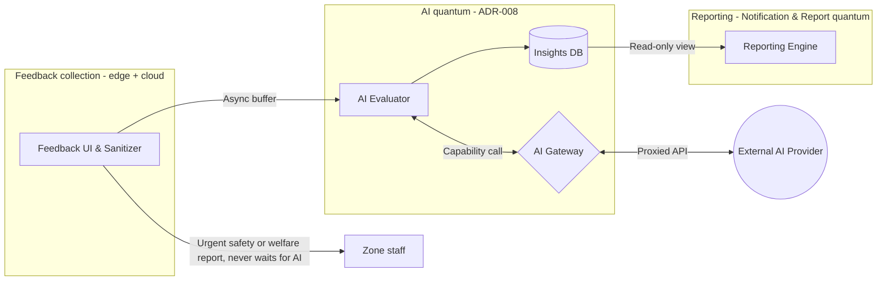
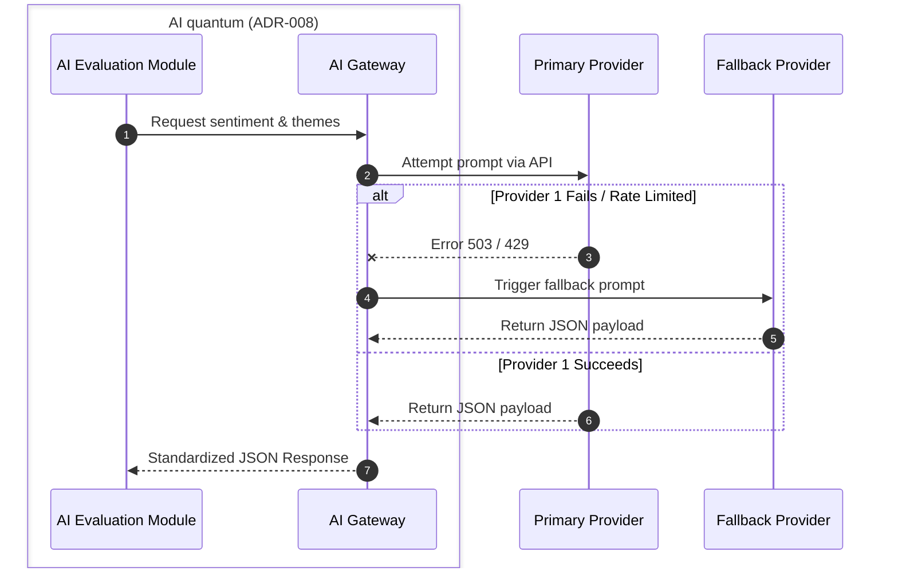

# ADR-006: AI Pipeline for Visitor Feedback Evaluation & Reporting

**Date:** 2026-09-16
**Status:** Accepted
**Amended:** 2026-10-07 (see Changelog)

## Context
Von Digitalis Estates requires a feedback and reporting system to extract actionable insights from unstructured visitor feedback regarding the 40 historic rides and 55 animal enclosures. 

The system must support:
*   Feedback collection via mobile app and estate kiosks
*   PII (Personally Identifiable Information) sanitization
*   AI-driven sentiment analysis and theme extraction
*   AI-driven operational suggestions (e.g., "Increase staff at jumping piranhas")
*   Deterministic executive reporting and dashboards

Because connectivity across the estate is patchy, feedback collection must support offline operation. Furthermore, due to the rapid evolution and unpredictability of GenAI models, the system must survive AI provider outages, model deprecations, and price hikes.

---

## Alternatives

### Option 1 — Asynchronous AI pipeline behind an abstraction gateway (Chosen)
Collect feedback at the edge, buffer it asynchronously to survive network drops, and evaluate it in the cloud through an AI Gateway that owns all external LLM interactions. The AI Evaluator and AI Gateway belong to the shared **AI quantum** ([ADR-008](adr-008-ai-quantum-and-gateway.md)). Feedback collection and deterministic reporting stay outside it, so reporting and PII handling do not ship with AI changes.

*The AI Gateway is the single place for routing, fallbacks and cost tracking, shielding the rest of the estate from provider volatility.*

### Option 2 — Direct Synchronous LLM Integration (Rejected)
The Collection UI synchronously calls the backend, which directly calls an external LLM provider's API.
*   **Problem:** Fatal dynamic connascence. If the AI provider is down, the visitor's app crashes.
*   **Problem:** High vendor lock-in.
*   **Problem:** PII leakage risk if sanitization fails in the synchronous loop.

---

## PrOACT (Trade-off Analysis)

| Requirement | Option 1: Async & Abstracted (Chosen) | Option 2: Direct Sync Integration (Rejected) |
| :--- | :--- | :--- |
| **High Availability (Offline Collection)** | High (Buffered locally at the edge) | Low (Fails on Wi-Fi/LLM drop) |
| **AI Change-Resilience (Vendor Swap)** | High (Config change at Gateway) | Low (Requires code rewrite) |
| **PII Security** | High (Stripped before buffer) | Medium (Risk of direct pass-through) |
| **Executive Reporting Reliability** | High (Queries structured DB) | Low (Subject to live hallucinations) |
| **System Complexity** | High (Requires internal buffers & gateways) | Low (Simple CRUD + API call) |

---

## Decision
We will implement the feedback pipeline as three modules with clear ownership. *Amended 2026-10-07:* this ADR originally placed all three modules in a single feedback quantum. The AI Evaluation & Gateway module now belongs to the shared AI quantum (ADR-008). Collection and reporting remain feedback-owned modules, and reporting sits with the Notification & Report quantum.

### 1. Edge Collection Module
**Responsibilities:**
*   Ingest raw text and ratings from visitors via mobile or kiosks.
*   Record two zone fields: **where the feedback was submitted** (from the QR code, kiosk or app location) and **the zone it is about** (asked of the visitor, with the submission zone as the default). A complaint at the aquarium exit may be about a ride visited earlier.
*   Deterministically strip PII.
*   Route **urgent safety or welfare reports** (keyword rules plus a visitor "this is urgent" option) straight to zone staff. This path never waits for, or depends on, AI evaluation.
*   Store payload locally if the estate network drops.
*   Push sanitized feedback to the internal event broker when connected.

### 2. AI Evaluation & Gateway Module (in the AI quantum, ADR-008)
**Responsibilities:**
*   Consume feedback events from the internal buffer.
*   Request sentiment and actionable suggestions via the AI Abstraction Gateway.
*   Manage AI model routing, failovers, and token cost tracking.
*   Parse non-deterministic JSON responses into structured data.
*   Persist structured insights to the Insights DB.

### 3. Deterministic Reporting Module
**Responsibilities:**
*   Query structured data from the Insights DB.
*   Serve deterministic reports (PDFs, dashboards) to Estate Management.
*   *Note: This module never calls the external LLM directly, avoiding the Vasa Anti-Pattern of over-complicating reporting with live AI.*

---

## Execution Flow (AI Evaluation Decision)
The AI Gateway is responsible for enforcing provider-agnostic rules and fallbacks, ensuring the feedback pipeline is never broken by an external third party.

---

## Offline & Failure Handling

Due to unreliable Wi-Fi across the sprawling estate, the Edge Collection module uses an internal buffer to prevent data loss. Urgent safety or welfare reports take a separate path straight to zone staff and never wait for the buffer or for AI evaluation.

**Connected State:**
`Submit Feedback` → `PII Strip` → `Push to Internal Broker` → `Cloud AI Evaluation`

**Connectivity Lost (Wi-Fi Drop):**
`Submit Feedback` → `PII Strip` → `Local Edge Cache` → `UI Success Message (Visitor continues day)`
*(When network restored)* → `Sync payload from Cache to Broker`

---

## Data Ownership

| Sub-Domain | Responsible Module | Data Store |
| :--- | :--- | :--- |
| **Raw Feedback** | Edge Collection | Not persisted. Held in memory only until PII is stripped |
| **Sanitized Payload (offline)** | Edge Collection | Local Edge SQLite Cache |
| **Sanitized Payload** | Message Broker | Internal MQTT / Kafka Log |
| **AI Insights/Sentiment** | AI Evaluation | Insights DB (PostgreSQL) |
| **Report Definitions** | Reporting | Insights DB (Read-Only) |

*Strict segregation ensures no module bypasses the DB schema to write data out of turn.*

---

## Communication Strategy

**Use synchronous APIs for deterministic user interactions:**
*   Visitor submitting a form (Local edge compute).
*   The Countess viewing a dashboard.
*   Internal AI Evaluator calling the AI Gateway.

**Use internal asynchronous events to buffer volatility:**
*   Pushing collected, sanitized feedback from the Edge nodes to the Cloud processing engine.

---

## Trade-offs & Mitigations

| Trade-off | Mitigation |
| :--- | :--- |
| **AI Gateway becomes a single point of failure** | Deploy Gateway in HA (Highly Available) clusters with horizontal scaling within the cloud partition. |
| **Async buffering means insights aren't instant** | Accept eventual consistency; executive reports are generated batch/hourly, not second-by-second. |
| **LLMs return malformed JSON disrupting the DB** | AI Gateway enforces strict JSON schema validation before passing data back to the Evaluator. |
| **Offline caches could fill up storage on Edge devices** | Implement aggressive compression and TTL (Time to Live) on edge caches, alerting maintenance if limits approach. |

---

## Enforcement

| Check | What it verifies | Evidence status |
|---|---|---|
| `reporting_never_calls_llm` (planned) | The reporting module has no dependency on the AI Gateway or any provider | Planned |
| `no_direct_provider_calls` (planned, ADR-008) | Only the AI quantum calls external providers | Planned |
| Feedback evaluator agreement rate | Agreement with a periodic human-labelled sample (including ambiguous, multilingual and rare urgent cases) stays above threshold | Designed |

## Changelog

- 2026-09-16: Accepted.
- 2026-10-07: Amended.
  - The AI Evaluator and AI Gateway moved to the AI quantum (ADR-008); collection and reporting stay outside it.
  - Added the two zone fields and the separate urgent-safety path.
  - Added the Enforcement section.
- 2026-10-08: Data Ownership corrected to match the offline flow: raw feedback is never persisted, and only sanitized payloads go to the Local Edge SQLite Cache. Offline handling no longer refers to the replaced unified quantum, and the Option 1 diagram now shows the urgent-report path. Decision unchanged.
